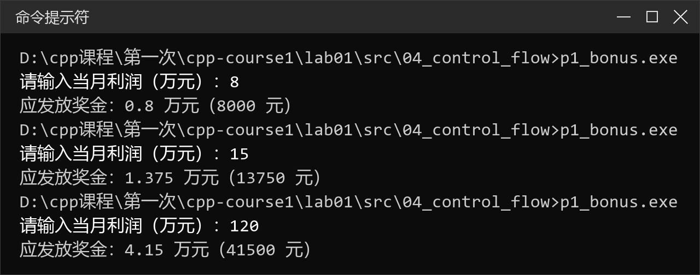
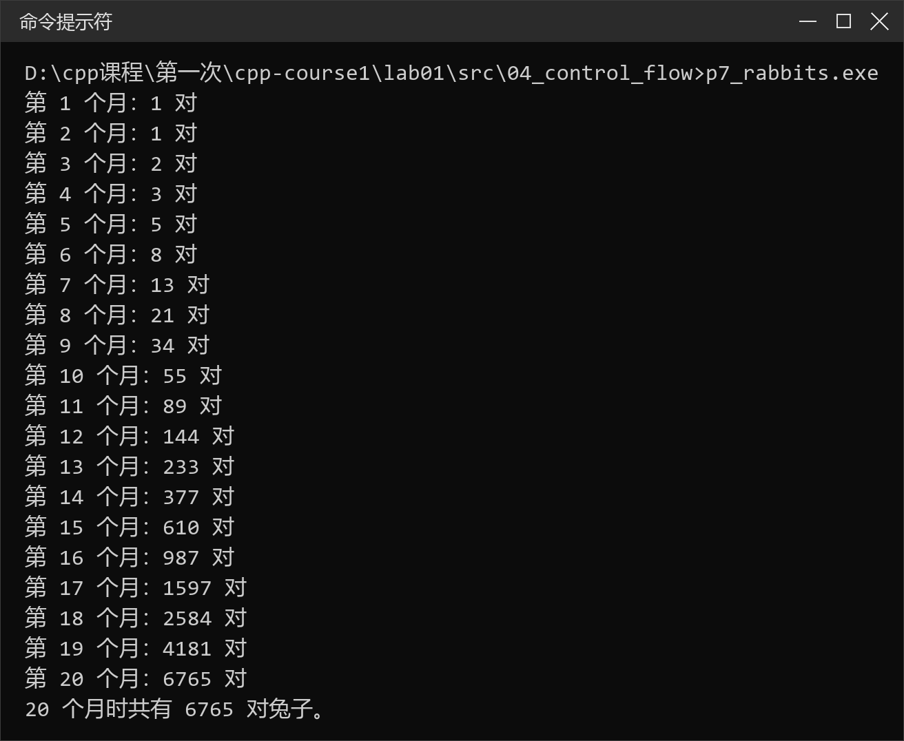
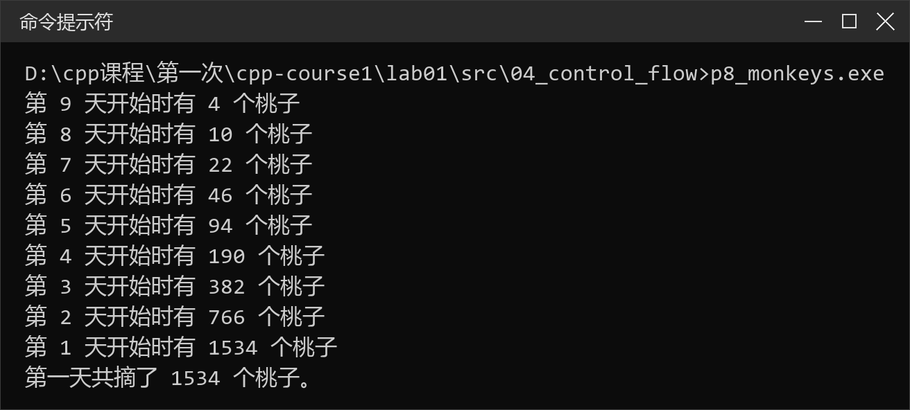

# 实验一　C++ 简单程序设计

## 一、实验目的

1. 学会编写简单的 C++ 程序；
2. 掌握基本数据类型变量和常量的应用；
3. 掌握运算符和表达式的应用；
4. 掌握结构化程序设计基本控制结构的运用；
5. 掌握简单的输入输出语句的运用；
6. 掌握头文件的运用；
7. 熟悉调试功能：单步执行、设置断点、观察变量值。

## 二、实验环境

| 项目 | 配置 |
| --- | --- |
| 操作系统 | Windows 11（10.0.26200） |
| 编译器 | MinGW-w64 GCC 8.1.0（g++，`-std=c++11`） |
| 编辑器 | Visual Studio Code |
| 编译运行 | 命令提示符 + g++ |

## 三、实验任务分解

本次实验按课件的四个课堂练习展开，每个题目单独建立一个源文件、单独编译运行。

### 3.1 练习一　基本数据类型

| 序号 | 程序 | 知识点 | 源文件 |
| --- | --- | --- | --- |
| 1 | 读入并显示整数 | `cin` / `cout`、变量的可变性 | [2-1_read_radius.cpp](src/01_basic_types/2-1_read_radius.cpp) |
| 2 | 为常量命名 | `const` 符号常量 | [2-2_const_pi.cpp](src/01_basic_types/2-2_const_pi.cpp) |
| 3 | 变量的初始化 | 定义时初始化 | [2-3_variable_init.cpp](src/01_basic_types/2-3_variable_init.cpp) |
| 4 | 有符号/无符号整数 | 溢出与补码解释 | [2-4_short_overflow.cpp](src/01_basic_types/2-4_short_overflow.cpp) |
| 5 | 各整数类型的最值 | `<climits>` 符号常量 | [2-5_integer_limits.cpp](src/01_basic_types/2-5_integer_limits.cpp) |
| 6 | 整型文字常量与进制 | `dec` / `oct` / `hex` | [2-6_radix.cpp](src/01_basic_types/2-6_radix.cpp) |
| 7 | 浮点类型 | `float` / `double` / `long double` | [2-7_float_types.cpp](src/01_basic_types/2-7_float_types.cpp) |
| 8 | 字符与转义序列 | `\t` `\b` `\a` | [2-8_char_data.cpp](src/01_basic_types/2-8_char_data.cpp) |
| 9 | `bool` 类型 | 布尔值与整数的转换 | [2-9_bool.cpp](src/01_basic_types/2-9_bool.cpp) |

设计要点：

- 变量在定义时一律给出初值，避免使用未初始化的随机值；
- 符号常量用 `const` 修饰，验证其不可被重新赋值；
- 通过 `short` 与 `unsigned short` 的对比，理解取值范围与补码表示；
- 浮点面积计算统一使用圆面积公式 `S = πr²`，比较三种浮点类型的精度与 `sizeof`。

### 3.2 练习二　算术运算符和赋值运算符

| 序号 | 程序 | 知识点 | 源文件 |
| --- | --- | --- | --- |
| 1 | 算术运算 | 整数除法、取模、`++` / `--` | [2-10_arithmetic.cpp](src/02_operators/2-10_arithmetic.cpp) |
| 2 | 赋值运算 | 赋值表达式的值、连续赋值 | [2-11_assignment.cpp](src/02_operators/2-11_assignment.cpp) |

设计要点：

- 用同一组数据分别做 `int/int`、`double/double`、混合类型运算，观察整数除法截断；
- 取模运算只用于整数，并测试负除数时结果符号；
- 分别以独立语句和同一表达式两种方式输出 `val1++`、`++val1`、`val1--`、`--val1`。同一表达式中多次修改同一变量属于未定义行为，g++ 会给出 `-Wsequence-point` 警告，这正说明“不要写依赖求值顺序的表达式”。

### 3.3 练习三　关系/逻辑运算符、`sizeof`、位运算

| 序号 | 程序 | 知识点 | 源文件 |
| --- | --- | --- | --- |
| 1 | 比较数据并输出结果 | 关系、相等、逻辑运算 | [2-12_compare.cpp](src/03_logic_sizeof_bitwise/2-12_compare.cpp) |
| 2 | `sizeof` 运算符 | 各基本类型的字节数 | [2-13_sizeof.cpp](src/03_logic_sizeof_bitwise/2-13_sizeof.cpp) |
| 3 | 位运算 | 与、或、异或、取反、移位 | [2-14_bitwise.cpp](src/03_logic_sizeof_bitwise/2-14_bitwise.cpp) |

设计要点：

- 关系与逻辑运算的结果均为 `bool`，输出为 `1/0`；
- 用 `sizeof` 实测本机类型长度：`short` 2 字节、`int`/`long` 4 字节、`float` 4 字节、`double` 8 字节、`long double` 16 字节、`char` 1 字节；
- 位运算程序中依次演示“置位 `|=`”“清位 `&= ~`”“翻转 `^=`”，并用循环把 `nTest` 的低 16 位逐位翻转，对照二进制结果理解运算规则。

### 3.4 练习四　结构化程序设计的控制结构

| 序号 | 题目 | 使用结构 | 源文件 |
| --- | --- | --- | --- |
| 1 | 企业奖金提成 | 多分支 `if-else` | [p1_bonus.cpp](src/04_control_flow/p1_bonus.cpp) |
| 2 | 电影评分评价 | 多分支 `if-else` | [p2_movie_score.cpp](src/04_control_flow/p2_movie_score.cpp) |
| 3 | 回文数判断 | `while` 循环、整数反转 | [p3_palindrome.cpp](src/04_control_flow/p3_palindrome.cpp) |
| 4 | 水仙花数 | `for` 循环、数位分解 | [p4_narcissistic.cpp](src/04_control_flow/p4_narcissistic.cpp) |
| 5 | a+aa+aaa+… 求和 | `for` 循环、递推构造 | [p5_series_sum.cpp](src/04_control_flow/p5_series_sum.cpp) |
| 6 | 9×9 乘法口诀表 | 嵌套循环 | [p6_multiplication_table.cpp](src/04_control_flow/p6_multiplication_table.cpp) |
| 7 | 兔子繁殖（斐波那契） | 递推循环 | [p7_rabbits.cpp](src/04_control_flow/p7_rabbits.cpp) |
| 8 | 猴子吃桃 | 逆推循环 | [p8_monkeys.cpp](src/04_control_flow/p8_monkeys.cpp) |

关键算法：

1. **奖金提成**：设利润为 `I`（万元），按分段累进计算。先判断 `I` 落在哪一档，再累加前面各档已满部分的奖金与当前档超出部分：

   ```text
   bonus = 0.10I                              I ≤ 10
         = 1      + 0.075(I − 10)             10 < I ≤ 20
         = 1.75   + 0.05 (I − 20)             20 < I ≤ 40
         = 2.75   + 0.03 (I − 40)             40 < I ≤ 60
         = 3.35   + 0.015(I − 60)             60 < I ≤ 100
         = 3.95   + 0.01 (I − 100)            I > 100
   ```

2. **电影评分**：`score ≥ 9` 输出“经典”，`7 ≤ score ≤ 8` 输出“非常好”，`5 ≤ score ≤ 6` 输出“一般”，其余输出“烂片”，并对 0～10 之外的输入给出提示。

3. **回文数**：保存原数，用 `reversed = reversed * 10 + n % 10` 逐位反转后比较。使用 `long long` 防止反转过程溢出；负数因带负号不视为回文数。

4. **水仙花数**：分解百位 `a`、十位 `b`、个位 `c`，判断 `a³+b³+c³` 是否等于原数；再用 `for (i = 100; i <= 999; ++i)` 输出全部结果。

5. **数列求和**：第 `i` 项由 `term = term * 10 + a` 递推得到，边构造边累加，用 `long long` 保存和。

6. **乘法口诀表**：外层循环控制行 `i`，内层循环 `j` 从 1 到 `i`，用 `setw(2)` 对齐乘积。

7. **兔子繁殖**：第 1、2 个月各 1 对，从第 3 个月起 `F(n) = F(n−1) + F(n−2)`，循环滚动保存前两项。

8. **猴子吃桃**：设第 `d` 天早上剩余 `x(d)`，则 `x(d−1) = (x(d) + 1) × 2`，从第 10 天的 1 个逆推到第 1 天。

## 四、目录结构

```text
lab01/
├── README.md
├── src/
│   ├── 01_basic_types/           # 练习一，9 个源文件
│   ├── 02_operators/             # 练习二，2 个源文件
│   ├── 03_logic_sizeof_bitwise/  # 练习三，3 个源文件
│   └── 04_control_flow/          # 练习四，8 个源文件
├── screenshots/                  # 22 个程序的运行结果截图
└── report/                       # 实验报告 docx
```

## 五、编译与运行

```bash
cd src/04_control_flow
g++ -std=c++11 -Wall p1_bonus.cpp -o p1_bonus.exe
./p1_bonus.exe
```

全部源文件均用 `g++ -std=c++11 -Wall -Wextra` 编译通过。唯一警告来自 `2-10_arithmetic.cpp` 中“同一表达式中多次修改 `val1`”，这是课件刻意保留的求值顺序示例。

## 六、运行结果

企业奖金提成（输入利润 8、15、120 万元）：



兔子繁殖（20 个月，斐波那契数列）：



猴子吃桃（逆推得到第一天 1534 个）：



其余题目的完整运行截图见 [screenshots/](screenshots/)。

## 七、思考题与实验结论

1. **能给 `const` 常量输入新值吗？** 不能。`pi` 是只读变量，执行 `cin >> pi` 会编译失败；定义 `const` 变量时必须初始化。
2. **50000 赋给 `short` 为什么输出 -15536？** `short` 的取值范围是 −32768～32767，50000 超出上限；按 16 位补码解释，50000 − 65536 = −15536。`unsigned short` 的范围是 0～65535，因此能正确保存 50000。
3. **`24 / 5` 与 `24 % 5` 的区别？** 两个整数相除结果取整为 4，小数部分被截掉；`%` 取余数，结果为 4。`%` 只能用于整数，浮点数取模无法通过编译。
4. **`val1++` 与 `++val1` 的区别？** 后置是先取值再自增，前置是先自增再取值。若在同一个表达式中多次修改同一变量，C++ 不规定求值顺序，结果不可移植，应拆成多条语句。
5. **位运算的用途？** `x |= 1 << k` 把第 k 位置 1，`x &= ~(1 << k)` 把第 k 位置 0，`x ^= 1 << k` 翻转第 k 位，常用于标志位管理与底层数据处理。

本次实验完成了基本数据类型、运算符、输入输出和控制结构的全部练习，理解了整数溢出、整数除法、求值顺序、位运算等容易出错的细节，并养成了“定义时初始化、编译时开警告、运行后对照输出分析”的习惯。
