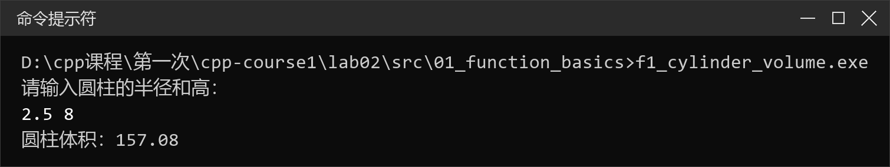
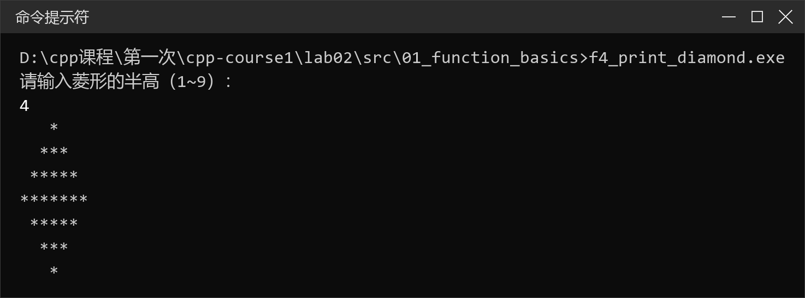
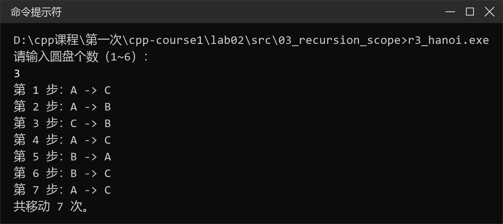
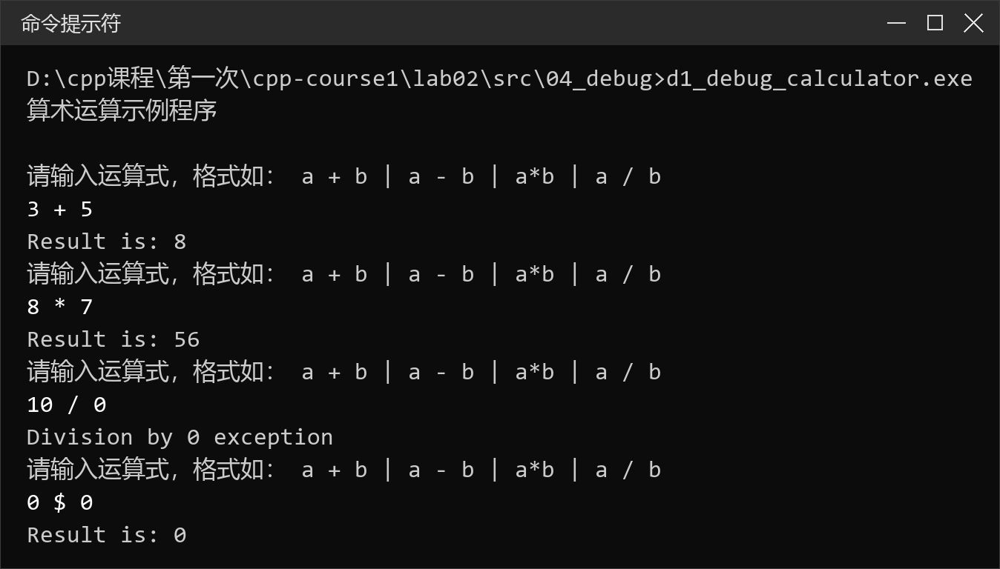

# 实验二　函数的使用与 IDE 调试

## 一、实验目的

1. 掌握函数的定义、声明与调用方法；
2. 掌握值传递、引用传递、数组参数和 `const` 参数的使用；
3. 掌握默认参数、函数重载等函数特性；
4. 理解递归的思想，能编写并分析递归函数；
5. 理解局部变量、静态局部变量和全局变量的作用域与生存期；
6. 掌握 VSCode + gdb 的调试方法：设置断点、单步执行、逐过程/逐语句、监视变量；
7. 养成“先分析、再编码、编译开警告、运行后验证”的习惯。

## 二、实验环境

| 项目 | 配置 |
| --- | --- |
| 操作系统 | Windows 11（10.0.26200） |
| 编译器 | MinGW-w64 GCC 8.1.0（g++，`-std=c++11`） |
| 编辑器 | Visual Studio Code + C/C++ 扩展（`ms-vscode.cpptools`） |
| 调试器 | GNU gdb 8.1（`D:\mingw64\bin\gdb.exe`） |
| 构建配置 | `.vscode/tasks.json`、`.vscode/launch.json` |
| 源码编码 | UTF-8；编译时用 `-fexec-charset=GBK` 保证中文控制台输出正常 |

## 三、实验任务分解

本次实验按“函数基础 → 参数传递 → 递归与作用域 → IDE 调试”四组展开，共 15 个源文件，每个题目单独编译运行。

### 3.1 练习一　函数的定义、声明与调用

| 序号 | 程序 | 知识点 | 源文件 |
| --- | --- | --- | --- |
| 1 | 计算圆柱体积 | 函数声明与定义分离、`const` 常量、`double` 返回值 | [f1_cylinder_volume.cpp](src/01_function_basics/f1_cylinder_volume.cpp) |
| 2 | 求最大公约数 | 函数封装循环、参数传递、负数处理 | [f2_gcd.cpp](src/01_function_basics/f2_gcd.cpp) |
| 3 | 输出 1~100 的素数 | `bool` 返回值、函数原型、`i * i <= n` 优化 | [f3_is_prime.cpp](src/01_function_basics/f3_is_prime.cpp) |
| 4 | 输出菱形 | `void` 函数、函数嵌套调用、参数控制输出 | [f4_print_diamond.cpp](src/01_function_basics/f4_print_diamond.cpp) |

设计要点：

- 函数声明写在 `main` 之前，定义写在 `main` 之后，体会“先声明、后使用”；
- 圆柱体积把 `π` 定义为 `const double`，避免魔法数字；
- 素数判断只试除到 `√n`，用 `i * i <= n` 避免调用 `sqrt` 的浮点误差；
- 菱形用 `printChars(count, ch)` 复用“连续输出字符”的逻辑，`printDiamond` 只负责控制行数与空格数。

### 3.2 练习二　参数传递与函数进阶

| 序号 | 程序 | 知识点 | 源文件 |
| --- | --- | --- | --- |
| 1 | 值传递与引用传递 | `int` 形参 vs `int &` 形参 | [p1_swap_value_reference.cpp](src/02_parameters/p1_swap_value_reference.cpp) |
| 2 | 默认参数 | 默认参数写在声明中、定义中不重复 | [p2_default_args.cpp](src/02_parameters/p2_default_args.cpp) |
| 3 | 函数重载 | 同名函数、参数列表不同 | [p3_overload_max.cpp](src/02_parameters/p3_overload_max.cpp) |
| 4 | 数组参数与 `const` | 数组退化为指针、`const` 防止修改 | [p4_array_average.cpp](src/02_parameters/p4_array_average.cpp) |

设计要点：

- `swapByValue` 交换的只是形参副本，调用后实参不变；`swapByReference` 通过引用直接修改实参；
- 默认参数只在函数声明中写一次，定义中再写会编译报错；
- 函数重载只看参数列表（类型、个数、顺序），与返回值类型无关；
- 数组参数实际传递的是首地址，必须另传长度；加 `const` 后函数内不能修改数组元素。

### 3.3 练习三　递归与变量作用域

| 序号 | 程序 | 知识点 | 源文件 |
| --- | --- | --- | --- |
| 1 | 递归求阶乘 | 递归终止条件、递归表达式、`unsigned long long` | [r1_factorial.cpp](src/03_recursion_scope/r1_factorial.cpp) |
| 2 | 斐波那契数列 | 递归与迭代对比、重复计算 | [r2_fibonacci.cpp](src/03_recursion_scope/r2_fibonacci.cpp) |
| 3 | 汉诺塔 | 递归分解、全局变量计数 | [r3_hanoi.cpp](src/03_recursion_scope/r3_hanoi.cpp) |
| 4 | 静态局部变量 | `static` 的生存期与初始化时机 | [r4_static_counter.cpp](src/03_recursion_scope/r4_static_counter.cpp) |

关键算法：

1. **阶乘**：`n! = n × (n−1)!`，终止条件 `n <= 1` 返回 1。`20! = 2432902008176640000`，仍在 `unsigned long long` 范围内。
2. **斐波那契**：递归式 `F(n) = F(n−1) + F(n−2)`，前两项为 1。递归写法直观，但 `F(n)` 会重复计算大量子问题，时间复杂度约 `O(2^n)`；迭代写法只保留前两项，时间复杂度 `O(n)`。
3. **汉诺塔**：把 `n` 个盘从 `from` 移到 `to`，先把上面 `n−1` 个移到 `via`，再移动最大的盘，最后把 `n−1` 个从 `via` 移到 `to`。移动次数为 `2^n − 1`。
4. **静态局部变量**：普通局部变量每次调用都重新初始化为 0；`static` 局部变量只在第一次调用时初始化，函数返回后仍然存在，下次调用继续累加。

### 3.4 练习四　IDE 调试

| 序号 | 程序 | 调试目的 | 源文件 |
| --- | --- | --- | --- |
| 1 | 算术运算示例（课件 DebugSample） | 断点、逐语句进入成员函数、监视变量 | [d1_debug_calculator.cpp](src/04_debug/d1_debug_calculator.cpp) |
| 2 | 平均分程序（含两处逻辑错误） | 用断点和单步定位逻辑错误 | [d2_debug_buggy.cpp](src/04_debug/d2_debug_buggy.cpp) |
| 3 | 平均分程序（修正版） | 对照验证修改结果 | [d3_average_fixed.cpp](src/04_debug/d3_average_fixed.cpp) |

调试要点：

- `d2` 的错误用眼睛不容易发现，但运行结果是 70，与手算的 88.2 不符；
- 在 `sum += scores[i]` 处设断点，逐次观察 `i`、`sum`，会发现循环在 `i == 4` 前就结束了（错误 1：`i < n - 1`）；
- 把循环改对后结果仍是 70，因为 `sum / n` 是两个整数相除，小数被截断（错误 2）；改成 `static_cast<double>(sum) / n` 后结果正确；
- 这两类错误编译器都不会报错，只能靠调试和对照预期结果发现。

## 四、目录结构

```text
lab02/
├── README.md
├── src/
│   ├── 01_function_basics/      # 练习一，4 个源文件
│   ├── 02_parameters/           # 练习二，4 个源文件
│   ├── 03_recursion_scope/      # 练习三，4 个源文件
│   └── 04_debug/                # 练习四，3 个源文件
└── screenshots/                 # 15 个程序的运行结果截图
```

仓库根目录的 `.vscode/` 已提交构建与调试配置，换一台机器只需把 `launch.json` 中的 `miDebuggerPath` 改成自己的 gdb 路径。

## 五、编译与运行

命令行方式：

```bash
cd src/01_function_basics
g++ -std=c++11 -Wall -Wextra -fexec-charset=GBK f1_cylinder_volume.cpp -o f1_cylinder_volume.exe
./f1_cylinder_volume.exe
```

VSCode 方式：

1. 用 VSCode 打开仓库根目录 `cpp-course1`；
2. 打开任意一个 `.cpp` 文件；
3. 按 `Ctrl+Shift+B` 只编译，或按 `Ctrl+F5` 编译并运行（任务 `run active file`）；
4. 需要输入的程序会在外部控制台窗口中等待键盘输入。

## 六、VSCode + gdb 调试步骤

以 `src/04_debug/d1_debug_calculator.cpp` 为例：

1. **安装扩展**：在扩展市场安装 `C/C++`（`ms-vscode.cpptools`）。
2. **设置断点**：单击 `result = c.Calculate(x, oper, y);` 这一行的行号左侧，出现红点；也可按 `F9`。
3. **启动调试**：按 `F5`，选择配置 **“g++ 调试当前文件”**。VSCode 会先执行 `build active file` 编译，再启动 gdb 和外部控制台。构建任务加了 `-static`，避免 gdb 启动时找不到动态库（0xc0000139）。
4. **输入数据**：在外部控制台输入 `3 + 5`，程序在断点处暂停。
5. **单步执行**：
   - `F10`（逐过程）：执行当前行，不进入 `Calculate` 内部；
   - `F11`（逐语句）：进入 `Calculator::Calculate`，观察 `x`、`oper`、`y` 的值；
   - `Shift+F11`（跳出）：从 `Calculate` 返回 `main`；
   - `F5`（继续）：运行到下一个断点或程序结束；
   - `Shift+F5`（停止调试）。
6. **观察变量**：左侧“变量”面板的“局部”区自动显示当前作用域的变量；在“监视”区手动添加 `x`、`oper`、`y`、`result`，逐行核对值是否符合预期。
7. **调试 `d2_debug_buggy.cpp`**：在 `sum += scores[i];` 设断点，重复按 `F10`，观察 `i` 从 0 到 3 后循环就结束；再把断点移到 `return sum / n;`，看到 `sum = 354`、`n = 5`，而返回值是 70，从而确认整数除法截断。

## 七、运行结果

圆柱体积（输入半径 2.5、高 8）：



菱形输出（半高 4）：



汉诺塔（3 个圆盘）：



调试示例（算术运算计算器）：



其余题目的完整运行截图见 [screenshots/](screenshots/)。

## 八、思考题与实验结论

1. **值传递和引用传递有什么区别？** 值传递把实参的值复制给形参，函数内修改形参不影响实参；引用传递让形参成为实参的别名，函数内修改形参会直接修改实参。需要“带回结果”时用引用或指针。
2. **默认参数为什么通常只写在声明里？** 编译器在调用点需要看到默认值；声明和定义分开时，若两处都写，属于重复指定，会编译报错。默认参数还必须从右向左连续设置。
3. **函数重载的依据是什么？** 参数的类型、个数或顺序不同即可重载；只有返回值类型不同不能构成重载，因为调用时无法根据返回值区分。
4. **递归必须包含哪两个要素？** 递归终止条件（基准情形）和向终止条件逼近的递归表达式。缺少终止条件会导致无限递归和栈溢出。
5. **静态局部变量和普通局部变量有什么区别？** 普通局部变量每次进入函数都重新创建并初始化；静态局部变量只在第一次调用时初始化，程序运行期间一直存在，但作用域仍限于函数内部。
6. **F10 和 F11 有什么区别？** `F10` 逐过程执行，遇到函数调用时把整个函数当作一步执行完；`F11` 逐语句执行，会进入被调用函数内部，适合检查函数内部的中间结果。

本次实验把“函数”这一章的知识点串了起来：从最简单的函数定义与调用，到参数传递方式、默认参数、重载，再到递归和作用域。最深的体会是，函数让程序从“一段流水账”变成了可复用的模块，而参数传递方式决定了函数能否把结果带回调用者。递归部分则让我直观看到“代码短”和“效率高”并不等价——斐波那契的递归写法简洁，但重复计算严重，迭代写法更可靠。

调试部分第一次真正用上了断点和单步。以前程序结果不对只能反复改代码、加 `cout`，现在可以在断点处停下来，逐个变量核对，很快就能定位到 `i < n - 1` 和整数除法这两处错误。也认识到：语法正确不等于逻辑正确，编译器不会替我们发现逻辑错误，必须用预期结果去对照。
